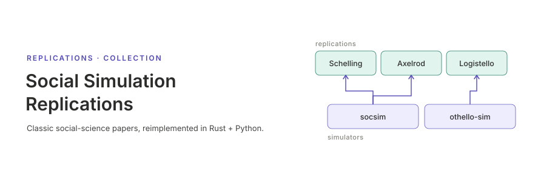

<p align="center"></p>

[English](README.md) | **日本語**

# Social Simulation Replications

社会科学系の古典的論文のシミュレーション再現実装と独自実験のプロジェクト集．各プロジェクトは独立したリポジトリとして Git Submodule で管理しています．

## Replications

<!-- BEGIN:replications (auto-generated by tools/gen_catalog.py — edit replications.toml then re-run) -->

全 27 件の再現実装を 3 カテゴリに分類しています．完全なカタログは [docs/replications.ja.md](docs/replications.ja.md) を参照してください．

### 古典的エージェントベースモデル

| 年 | 論文 | テーマ | リポジトリ |
|----|------|--------|------------|
| 1971 | Schelling, "Dynamic Models of Segregation" | 住み分け（分居） | [rep-schelling1971](https://github.com/akitenkrad/rep-schelling1971) |
| 1973 | Granovetter, "The Strength of Weak Ties" | 弱い紐帯・ネットワーク | [rep-granovetter1973](https://github.com/akitenkrad/rep-granovetter1973) |
| 1974 | Noelle-Neumann, "The Spiral of Silence: A Theory of Public Opinion" | 沈黙の螺旋 (世論形成) | [rep-noelleneumann1974](https://github.com/akitenkrad/rep-noelleneumann1974) |
| 1997 | Axelrod, "The Dissemination of Culture" | 文化の伝播 | [rep-axelrod1997](https://github.com/akitenkrad/rep-axelrod1997) |
| 2002 | Hegselmann & Krause, "Opinion Dynamics and Bounded Confidence: Models, Analysis and Simulation" | 限定信頼モデル | [rep-hegselmann2002](https://github.com/akitenkrad/rep-hegselmann2002) |
| 2005 | Hegselmann & Krause, "Opinion Dynamics Driven by Various Ways of Averaging" | 意見ダイナミクス (平均演算子) | [rep-hegselmann2005](https://github.com/akitenkrad/rep-hegselmann2005) |

### LLM ベースの社会シミュレーション

#### 意見・規範・集合行動

| 年 | 論文 | テーマ | リポジトリ |
|----|------|--------|------------|
| 1999 | Edmondson, "Psychological Safety and Learning Behavior in Work Teams" | 心理的安全性とチーム学習 | [rep-edmondson1999](https://github.com/akitenkrad/rep-edmondson1999) |
| 2011 | Detert & Edmondson, "Implicit Voice Theories: Taken-for-Granted Rules of Self-Censorship at Work" | 暗黙の発言理論 (自己検閲) | [rep-detert2011](https://github.com/akitenkrad/rep-detert2011) |
| 2013 | Knoll & van Dick, "Do I Hear the Whistle…? A First Attempt to Measure Four Forms of Employee Silence and Their Correlates" | 従業員サイレンス (4 動機形態) | [rep-knoll2013](https://github.com/akitenkrad/rep-knoll2013) |
| 2013 | Brinsfield, "Employee Silence Motives: Investigation of Dimensionality and Development of Measures" | 従業員サイレンス (6 動機次元) | [rep-brinsfield2013](https://github.com/akitenkrad/rep-brinsfield2013) |
| 2019 | Fujimura & Hino, "Silence and Voice in the Organization: The Influences of Silence Motives and Psychological Safety" | 沈黙・発言の規定要因 SEM (日本) | [rep-fujimura2019](https://github.com/akitenkrad/rep-fujimura2019) |
| 2023 | Argyle et al., "Out of One, Many: Using Language Models to Simulate Human Samples" | シリコンサンプル (世論・調査) | [rep-argyle2023](https://github.com/akitenkrad/rep-argyle2023) |
| 2024 | Chuang et al., "Simulating Opinion Dynamics with Networks of LLM-based Agents" | 意見ダイナミクス | [rep-chuang2024](https://github.com/akitenkrad/rep-chuang2024) |
| 2024 | Ren et al., "Emergence of Social Norms in Generative Agent Societies (CRSEC)" | 社会規範 | [rep-ren2024](https://github.com/akitenkrad/rep-ren2024) |
| 2024 | Mou et al., "Unveiling the Truth and Facilitating Change: Towards Agent-based Large-scale Social Movement Simulation (HiSim)" | 社会運動 | [rep-mou2024](https://github.com/akitenkrad/rep-mou2024) |
| 2024 | Sun et al., "Random Silicon Sampling: Simulating Human Sub-Population Opinion Using a Large Language Model Based on Group-Level Demographic Information" | 集団レベルのシリコンサンプリング (logprob 非依存) | [rep-sun2024](https://github.com/akitenkrad/rep-sun2024) |
| 2026 | Gong et al., "Characterizing the Ability of LLMs to Recapitulate Americans' Distributional Responses to Public Opinion Polling Questions Across Political Issues" | 分布直接予測 (DD) と個人反復 (SI) の比較 (logprob 非依存) | [rep-gong2026](https://github.com/akitenkrad/rep-gong2026) |

#### 経済・市場・資源

| 年 | 論文 | テーマ | リポジトリ |
|----|------|--------|------------|
| 2023 | Han et al., "Guinea Pig Trials Utilizing GPT: A Smart Agent-Based Modeling Approach for Studying Firm Competition and Collusion (SABM)" | 企業間競争・共謀 | [rep-han2023](https://github.com/akitenkrad/rep-han2023) |
| 2024 | Li et al., "EconAgent: LLM-Empowered Agents for Simulating Macroeconomic Activities" | マクロ経済 | [rep-li2024](https://github.com/akitenkrad/rep-li2024) |
| 2024 | Ji et al., "SRAP-Agent: Simulating and Optimizing Scarce Resource Allocation Policy with LLM-based Agent" | 資源配分 | [rep-ji2024](https://github.com/akitenkrad/rep-ji2024) |

#### 競争・紛争

| 年 | 論文 | テーマ | リポジトリ |
|----|------|--------|------------|
| 2024 | Zhao et al., "CompeteAI: Understanding the Competition Dynamics of LLM-based Agents" | 競争 | [rep-zhao2024](https://github.com/akitenkrad/rep-zhao2024) |
| 2024 | Hua et al., "War and Peace (WarAgent): LLM-based Multi-Agent Simulation of World Wars" | 国際紛争 | [rep-hua2024](https://github.com/akitenkrad/rep-hua2024) |

#### 基盤・大規模シミュレータ

| 年 | 論文 | テーマ | リポジトリ |
|----|------|--------|------------|
| 2023 | Gao et al., "S3: Social-network Simulation System with LLM-Empowered Agents" | ソーシャルネットワーク基盤 | [rep-gao2023](https://github.com/akitenkrad/rep-gao2023) |
| 2024 | Yang et al., "OASIS: Open Agent Social Interaction Simulations with One Million Agents" | 大規模シミュレーション基盤 | [rep-yang2024](https://github.com/akitenkrad/rep-yang2024) |
| 2025 | Wang et al., "YuLan-OneSim: Towards the Next Generation of Social Simulator with Large Language Models" | シミュレータ基盤 | [rep-wang2025](https://github.com/akitenkrad/rep-wang2025) |

#### 認知バイアス・行動評価

| 年 | 論文 | テーマ | リポジトリ |
|----|------|--------|------------|
| 2022 | Jones & Steinhardt, "Capturing Failures of Large Language Models via Human Cognitive Biases" | 人間の認知バイアスを介した LLM の質的失敗の誘発 | [rep-jones2022](https://github.com/akitenkrad/rep-jones2022) |

### ゲーム AI・その他

| 年 | 論文 | テーマ | リポジトリ |
|----|------|--------|------------|
| 1994–1999 | Buro, "Logistello (7 papers)" | オセロのゲーム AI | [rep-logistello](https://github.com/akitenkrad/rep-logistello) |

<!-- END:replications -->

## Experiments

<!-- BEGIN:experiments (auto-generated by tools/gen_catalog.py — edit replications.toml then re-run) -->
| 年 | 実験 | テーマ | リポジトリ |
|----|------|--------|------------|
| 2026 | Majority accuracy under correlated votes | 相関のある陪審定理（似かたの強さと構造） | [exp-correlated-jury-theorem](https://github.com/akitenkrad/exp-correlated-jury-theorem) |
| 2026 | Escalation of LLM agents in the dollar auction | ドル・オークションのエスカレーション（理論・人間・LLM） | [exp-dollar-auction-escalation](https://github.com/akitenkrad/exp-dollar-auction-escalation) |
| 2026 | Solving tic-tac-toe where the oldest mark vanishes | 古い手が消える○×ゲーム（閉路のあるゲームの後退解析） | [exp-fifo-tic-tac-toe](https://github.com/akitenkrad/exp-fifo-tic-tac-toe) |
| 2026 | Round-robin tournament of iterated prisoner's dilemma strategies | 繰り返し囚人のジレンマの戦略（18 戦略の総当たり） | [exp-ipd-strategies](https://github.com/akitenkrad/exp-ipd-strategies) |
| 2026 | Rumor spreading with forgetting on networks | 忘却のある噂の伝播と定着（Maki–Thompson） | [exp-rumor-forgetting](https://github.com/akitenkrad/exp-rumor-forgetting) |
<!-- END:experiments -->

## Simulators

汎用シミュレータコンポーネント．特定の論文の再現ではなく，再現実験や強化学習研究の基盤として横断的に使えるフレームワークを `simulators/` 配下に配置しています．

| 名称 | ディレクトリ |
|------|-------------|
| rs-social-simulation-tools | [simulators/rs-social-simulation-tools](https://github.com/akitenkrad/rs-social-simulation-tools) |
| rs-othello-sim | [simulators/rs-othello-sim](https://github.com/akitenkrad/rs-othello-sim) |
| rs-runvault-socsim | [simulators/rs-runvault-socsim](https://github.com/akitenkrad/rs-runvault-socsim) |

## Getting Started

```bash
# Submodule を含めてクローン
git clone --recurse-submodules git@github.com:akitenkrad/social-simulation-replications.git

# 既にクローン済みの場合は Submodule を取得
git submodule update --init --recursive
```

各実装の詳細な実行方法は，それぞれのディレクトリ内の README を参照してください．

## Documentation

- [Adding a Replication](docs/adding-a-replication.ja.md) — テンプレートから新規 Replication を作成する方法．
- [Adding an Experiment](docs/adding-an-experiment.ja.md) — テンプレートから新規実験を作成する方法．
- [新規実験カタログ](docs/experiments.ja.md) — このモノレポに登録された独自実験の一覧．

## License

MIT
